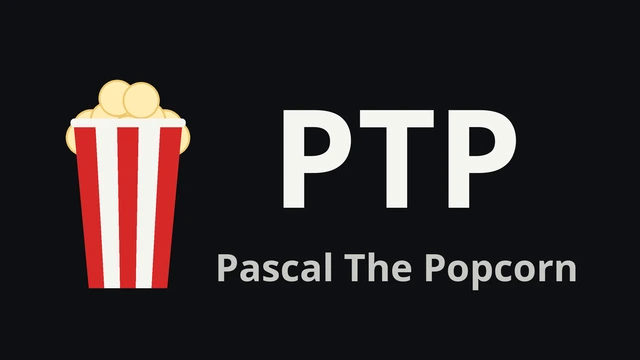

<p align="center"></p>

# Pascal The Popcorn

A simple, private movie and TV app for Android TV / Google TV. Search for something, press Play, and it starts the best source for your TV, straight away.

**Current version: 1.0** · [Download the APK from Releases](../../releases/latest) · [What's new](CHANGELOG.md)

> **Private.** The app has personal keys and addon addresses built in. Keep this repository private; if it ever has to be shared, rotate those first.

## What it does

- **Two screens:** **Search** and **Home**. Home shows only your **Continue Watching** row, so you pick up where you left off. **Settings** is the gear at the top right.
- **Play just plays.** It looks at the sources Usenet Ultimate returns and starts the first one that suits your TV. No list to scroll through. See [How Play picks a source](docs/how-play-picks-a-source.md).
- **Knows your TV.** On first launch it checks once what your TV can do (chip, video formats, screen resolution, HDR, Dolby Vision, sound formats) and remembers it.
- **Follows Usenet Ultimate.** Its sources are used in its own order; the app never re-ranks or filters them.
- **Retries by itself.** If a source doesn't start, it tries the next suitable one (up to 3 in total).
- **Waits for Usenet.** A first play can take up to 30–40 seconds while the server fetches the file; the app waits instead of giving up.
- **Subtitles on by default:** English subtitles, original-language audio. Next-episode autoplay is off.
- **No accounts, no cloud, no profiles.** Nothing to sign in to; no sync, no analytics, no crash reporting.

## Requirements

- An Android TV or Google TV device (32-bit or 64-bit ARM — one APK covers both).
- Your **Usenet Ultimate** addon reachable from the TV. It runs on your home server, so **Tailscale must be connected on the TV** (open the Tailscale app and switch it on if searches say "no sources").

## Install

**With Downloader (on the TV):**
1. Install **Downloader** from the Play Store.
2. Allow it to install unknown apps when asked (Settings → Apps → Security & restrictions → Unknown sources → Downloader).
3. Download `Pascal-The-Popcorn-1.0.apk` from this repo's Releases page and open it to install.

**With ADB (from a computer on the same network):**
```sh
adb connect <tv-ip>:5555
adb install Pascal-The-Popcorn-1.0.apk
```

**Upgrading:** installing a newer APK over the old one keeps your Continue Watching and settings.

## First launch

1. Open **Pascal The Popcorn** from your TV's apps row.
2. It opens straight to **Home** (no "Who's watching?").
3. In the background it scans your TV once; you can see the result in **Settings → Playback → This TV**.
4. Use **Search**, pick a movie or episode, press **Play**.

Home is empty until you've watched something — that's normal. Start with Search.

## Settings worth knowing

| Setting | Where | What it does |
|---|---|---|
| **Show all sources** | Settings → Playback | Off (default): Play starts the best source for this TV. On: Play opens the full source list, in Usenet Ultimate's order, and plays exactly what you pick. |
| **This TV / Re-scan TV** | Settings → Playback | Shows what the app found out about your TV. Re-scan after a TV software update. |
| **Subtitles** | Settings → Subtitles | Default English. Choose Off or another language. |
| **Audio language** | Settings → Language & Audio | Default: the title's original audio. |
| **Autoplay next episode** | Settings → Playback | Off by default. |

## Troubleshooting

| What you see | What to do |
|---|---|
| "No sources" on every title | Tailscale is off on the TV. Open Tailscale and connect, then try again. |
| A first play takes 30+ seconds | Normal for a title the server hasn't fetched yet. Later plays start faster. |
| "Playback Error" after a long wait | The app already tried up to 3 sources. Press **Retry**, or turn on **Show all sources** and pick one yourself. |
| Wrong colours (purple/green) | That source is Dolby Vision-only and your TV lacks Dolby Vision. Press Back and choose another source with Show all sources on; tell the maintainer so the picker can be checked. |
| Settings → This TV says "Not scanned yet" | Press **Re-scan TV**. |

## Documentation

- [How Play picks a source](docs/how-play-picks-a-source.md)
- [Changelog](CHANGELOG.md)
